# 04 — Database Schema & ERD (MySQL 8, InnoDB, utf8mb4)

## Conventions

- Every table: `id BIGINT UNSIGNED PK AI`, `created_at`, `updated_at` (UTC). Soft deletes (`deleted_at`) on master data; **clinical and financial records are never hard-deleted** (void/cancel/addendum instead).
- **T** = tenant table → has `organization_id BIGINT UNSIGNED NOT NULL` + index, scoped by `BelongsToTenant`.
- **B** = also branch-scoped → `branch_id NOT NULL`.
- `ulid CHAR(26) UNIQUE` on externally addressable rows (marked **U**).
- Money = `BIGINT` paise. Percentages = `DECIMAL(5,2)`. Status/type columns = `VARCHAR(32)` mapped to PHP enums.
- `created_by`/`updated_by` → `users.id` (nullable) on business tables.
- Composite FK `(organization_id, x_id) → x(organization_id, id)` where noted (**CFK**); parent tables therefore carry `UNIQUE(organization_id, id)`.
- JSON columns only for genuinely schemaless data (template definitions, section data, settings, provider payloads).

---

## 1. Platform & SaaS

| Table | Key columns | Indexes / notes |
|---|---|---|
| `platform_users` | name, email, password, two_factor_secret (enc), role, status, last_login_at | UNIQUE(email) |
| `plans` | code, name, description, price_monthly, price_annual, currency, trial_days, limits JSON (`max_doctors`, `max_branches`, `max_staff`, `storage_gb`, `whatsapp_quota`), is_public, is_active, sort | UNIQUE(code) |
| `features` | key (`inventory`, `lab`, `speciality.dental`, `ai.analytics`, `patient_app`…), name, description | UNIQUE(key) |
| `plan_features` | plan_id, feature_id, limit_value NULL | PK(plan_id, feature_id) |
| `organizations` **U** | name, legal_name, slug, logo_path, email, phone, gstin, registration_no, address JSON, country, default_timezone, currency, status (`pending`,`active`,`suspended`,`closed`), approved_at, approved_by, suspended_reason, settings JSON, data_region | UNIQUE(slug), INDEX(status) |
| `subscriptions` | organization_id, plan_id, status (`trialing`,`active`,`past_due`,`grace`,`suspended`,`cancelled`), billing_cycle (`monthly`,`annual`), trial_ends_at, current_period_start, current_period_end, cancel_at, gateway, gateway_subscription_id, overrides JSON (custom limits) | INDEX(organization_id, status), INDEX(current_period_end) |
| `subscription_invoices` **U** | organization_id, subscription_id, number, period_start, period_end, subtotal, tax, total, status, due_at, paid_at, pdf_path | UNIQUE(number) |
| `subscription_payments` | subscription_invoice_id, amount, method, gateway_payment_id, status, paid_at, raw JSON | |
| `organization_features` | organization_id, feature_key, enabled, source (`plan`,`override`) | UNIQUE(organization_id, feature_key) |
| `usage_counters` | organization_id, metric, period (YYYY-MM), value | UNIQUE(organization_id, metric, period) |
| `specialities` | code, name, description, icon, is_active | UNIQUE(code) |
| `modules` | key, name, speciality_id NULL, feature_key, version | UNIQUE(key) |
| `global_settings` | key, value JSON | UNIQUE(key) |
| `integration_providers` | organization_id NULL (NULL = platform default), channel (`whatsapp`,`sms`,`email`,`payment`,`ai`), provider, credentials (enc JSON), is_active | INDEX(organization_id, channel) |
| `platform_audit_logs` | platform_user_id, action, target_type, target_id, organization_id NULL, meta JSON, ip, user_agent | INDEX(organization_id, created_at) |
| `impersonation_sessions` | platform_user_id, organization_id, user_id, reason, ticket_ref, started_at, expires_at, ended_at | |

## 2. Identity, membership & access

| Table | Key columns | Indexes / notes |
|---|---|---|
| `users` **U** | name, email NULL, mobile NULL, password, email_verified_at, mobile_verified_at, two_factor_secret (enc), two_factor_confirmed_at, status, last_login_at, locale | UNIQUE(email), UNIQUE(mobile) |
| `organization_user` (memberships) **T** | organization_id, user_id, status (`invited`,`active`,`disabled`), all_branches BOOL, invited_by, joined_at, employee_code, designation, department_id NULL | UNIQUE(organization_id, user_id) |
| `branch_user` **T** | organization_id, branch_id, user_id | UNIQUE(branch_id, user_id) |
| `roles` (Spatie, teams) | organization_id NULL (= team_id; NULL = system template), name, guard_name, is_system, description | UNIQUE(organization_id, name, guard_name) |
| `permissions` | name, guard_name, module | UNIQUE(name, guard_name) |
| `role_has_permissions`, `model_has_roles` (with `organization_id`), `model_has_permissions` | Spatie standard + team column | |
| `staff_invitations` **T** | organization_id, email/mobile, role_ids JSON, branch_ids JSON, token_hash, expires_at, accepted_at | INDEX(token_hash) |
| `personal_access_tokens` | Sanctum standard + `organization_id` (active tenant for the token) | |
| `sessions` | Laravel standard (Redis in prod) | |
| `login_attempts` | identifier, ip, success, created_at | INDEX(identifier, created_at) |
| `audit_logs` **T** | organization_id, branch_id NULL, user_id NULL, impersonator_id NULL, event (`created`,`updated`,`deleted`,`viewed`,`exported`,`login`…), auditable_type, auditable_id, old_values JSON, new_values JSON, ip, user_agent, request_id | INDEX(organization_id, created_at), INDEX(auditable_type, auditable_id), INDEX(organization_id, user_id, created_at). **Append-only** (no UPDATE/DELETE grants for app DB user). Monthly range partitions. |

## 3. Organisation structure

| Table | Key columns | Indexes / notes |
|---|---|---|
| `branches` **T U** | organization_id, name, code, address JSON, phone, email, timezone, gstin NULL, state_code (for GST place-of-supply), letterhead_path, invoice_prefix, is_active | UNIQUE(organization_id, code), UNIQUE(organization_id, id) |
| `organization_specialities` **T** | organization_id, speciality_id | UNIQUE(organization_id, speciality_id) |
| `organization_modules` **T** | organization_id, module_id, enabled, settings JSON | UNIQUE(organization_id, module_id) |
| `departments` **T** | organization_id, name, speciality_id NULL | UNIQUE(organization_id, name) |
| `operating_hours` **T B** | organization_id, branch_id, weekday (0–6), opens_at TIME, closes_at TIME (multiple rows per day = sessions) | INDEX(branch_id, weekday) |
| `holidays` **T** | organization_id, branch_id NULL (NULL = all branches), date, name, is_full_day, starts_at NULL, ends_at NULL | INDEX(organization_id, date) |
| `tax_rates` **T** | organization_id, name, rate DECIMAL(5,2), type (`gst`,`none`), cgst, sgst, igst, is_default | |
| `services` **T** | organization_id, code, name, type (`consultation`,`procedure`,`diagnostic`,`package`,`other`), department_id NULL, speciality_id NULL, price, tax_rate_id NULL, hsn_sac, duration_min NULL, is_active | UNIQUE(organization_id, code) |
| `service_branch_prices` **T** | organization_id, service_id, branch_id, price | UNIQUE(service_id, branch_id) |
| `sequences` **T** | organization_id, branch_id NULL, key (`patient`,`invoice`,`receipt`,`token`…), period (`2026`, `2026-11-16`, `FY2026-27`), next_value | UNIQUE(organization_id, branch_id, key, period) — row-locked |
| `organization_settings` | (kept in `organizations.settings` JSON; typed via `OrgSettings` DTO with defaults) | |

## 4. Doctors & schedules

| Table | Key columns | Indexes / notes |
|---|---|---|
| `doctor_profiles` **T U** | organization_id, user_id, title, qualifications JSON, registration_council, registration_number, experience_years, bio, signature_path, photo_path, consultation_duration_min, is_bookable_online | UNIQUE(organization_id, user_id), UNIQUE(organization_id, id) |
| `doctor_specialities` **T** | organization_id, doctor_profile_id, speciality_id, is_primary | UNIQUE(doctor_profile_id, speciality_id) |
| `doctor_branch` **T** | organization_id, doctor_profile_id, branch_id | UNIQUE |
| `doctor_fees` **T** | organization_id, doctor_profile_id, branch_id NULL, fee_type (`new`,`follow_up`,`emergency`,`online`), amount, follow_up_window_days | UNIQUE(doctor_profile_id, branch_id, fee_type) |
| `doctor_schedules` **T B** | organization_id, branch_id, doctor_profile_id, weekday, start_time, end_time, slot_minutes, max_patients NULL, allow_walk_in, effective_from, effective_to NULL | INDEX(doctor_profile_id, branch_id, weekday) |
| `doctor_leaves` **T** | organization_id, doctor_profile_id, branch_id NULL, starts_at, ends_at, reason, status (`approved`,`pending`,`rejected`), created_by | INDEX(doctor_profile_id, starts_at, ends_at) |

## 5. Patients

| Table | Key columns | Indexes / notes |
|---|---|---|
| `patients` **T U** | organization_id, patient_code, first_name, last_name, full_name (generated/stored, for search), gender, date_of_birth NULL, age_years_at_registration NULL (when DOB unknown), mobile (E.164 normalised), alt_mobile, email, blood_group, address JSON, city, pincode, abha_number (enc), abha_address, emergency_contact JSON, guardian_patient_id NULL, registered_branch_id, preferred_language, photo_path, notes, is_deceased, merged_into_id NULL, patient_account_id NULL | UNIQUE(organization_id, patient_code), UNIQUE(organization_id, id), INDEX(organization_id, mobile), INDEX(organization_id, last_name, first_name), FULLTEXT(full_name) (ngram parser) |
| `patient_allergies` **T** | organization_id, patient_id (CFK), allergen, allergen_type (`drug`,`food`,`environmental`), reaction, severity (`mild`,`moderate`,`severe`), recorded_by | INDEX(patient_id) |
| `patient_conditions` **T** | organization_id, patient_id, name, icd10_code NULL, status (`active`,`resolved`), since_date | |
| `patient_medications` **T** | organization_id, patient_id, name, dosage, since_date, is_active, source (`reported`,`prescribed`) | |
| `patient_medical_history` **T** | organization_id, patient_id, type (`past_illness`,`surgery`,`family`,`social`), description, date NULL | |
| `patient_documents` **T U** | organization_id, patient_id, branch_id, category (`report`,`prescription_external`,`imaging`,`clinical_photo`,`consent`,`id_proof`,`other`), title, file_path, mime, size_bytes, sha256, scan_status (`pending`,`clean`,`infected`), is_sensitive, consultation_id NULL, lab_order_id NULL, uploaded_by, shared_with_patient_at NULL | INDEX(organization_id, patient_id, category) |
| `consents` **T** | organization_id, patient_id, purpose (`data_processing`,`whatsapp`,`sms`,`email`,`clinical_photos`,`ai_processing`,`share_with_patient_app`), status (`granted`,`revoked`), version, method (`in_person_signed`,`otp`,`app`), evidence_document_id NULL, granted_at, revoked_at, recorded_by | INDEX(patient_id, purpose) |

## 6. Appointments & queue

| Table | Key columns | Indexes / notes |
|---|---|---|
| `appointments` **T B U** | organization_id, branch_id, patient_id (CFK), doctor_profile_id (CFK), speciality_id NULL, service_id NULL, type (`scheduled`,`walk_in`,`follow_up`,`online`), source (`reception`,`phone`,`patient_app`,`public_page`), scheduled_start DATETIME, scheduled_end, status (`booked`,`confirmed`,`checked_in`,`waiting`,`in_consultation`,`completed`,`cancelled`,`no_show`), checked_in_at, consult_started_at, consult_ended_at, cancelled_at, cancel_reason, cancelled_by, rescheduled_from_id NULL, notes, **slot_lock** (generated, see below), created_by | INDEX(organization_id, branch_id, scheduled_start), INDEX(doctor_profile_id, scheduled_start), INDEX(organization_id, patient_id, scheduled_start), INDEX(organization_id, status, scheduled_start), **UNIQUE(slot_lock)** |
| `appointment_status_history` **T** | organization_id, appointment_id, from_status, to_status, changed_by, reason, changed_at | INDEX(appointment_id) |
| `waitlist_entries` **T B** | organization_id, branch_id, patient_id, doctor_profile_id NULL, preferred_date, preferred_window JSON, status (`waiting`,`offered`,`booked`,`expired`), offered_appointment_id NULL | INDEX(branch_id, preferred_date, status) |
| `queue_tokens` **T B** | organization_id, branch_id, doctor_profile_id, appointment_id UNIQUE, queue_date DATE, token_number INT, token_label (`D1-014`), priority (`normal`,`priority`,`emergency`), status (`waiting`,`called`,`in_consultation`,`skipped`,`completed`,`transferred`), called_at, called_count, started_at, completed_at, position_hint | UNIQUE(organization_id, branch_id, doctor_profile_id, queue_date, token_number), INDEX(doctor_profile_id, queue_date, status) |
| `queue_displays` **T B** | organization_id, branch_id, name, access_token_hash, doctor_ids JSON, settings JSON | |

**Double-booking prevention (DB-enforced).** MySQL lacks partial unique indexes, so:

```sql
slot_lock VARCHAR(64) GENERATED ALWAYS AS (
  CASE WHEN status IN ('booked','confirmed','checked_in','waiting','in_consultation')
            AND type <> 'walk_in'
       THEN CONCAT(doctor_profile_id, '|', DATE_FORMAT(scheduled_start,'%Y%m%d%H%i'))
  END) STORED,
UNIQUE KEY uq_appointments_slot_lock (slot_lock)   -- NULLs are not unique-checked
```
The `BookAppointment` action additionally takes a Redis lock `slot:{doctor}:{start}` and checks overlapping ranges for variable-length slots inside a transaction; the unique key is the last line of defence. Walk-ins bypass the slot (they join the token queue).

## 7. Consultations & templates

| Table | Key columns | Indexes / notes |
|---|---|---|
| `consultation_templates` | organization_id NULL (NULL = platform template), speciality_id NULL, name, key, version INT, definition JSON, is_default, is_active, parent_template_id NULL (cloned from) | UNIQUE(organization_id, key, version) |
| `consultations` **T B U** | organization_id, branch_id, patient_id (CFK), doctor_profile_id (CFK), appointment_id NULL UNIQUE, template_id, template_version, status (`draft`,`signed`,`amended`), chief_complaint TEXT, notes (enc TEXT), follow_up_date NULL, follow_up_notes, signed_at, signed_by, started_at, ended_at | INDEX(organization_id, patient_id, created_at), INDEX(doctor_profile_id, created_at), INDEX(organization_id, follow_up_date) |
| `consultation_sections` **T** | organization_id, consultation_id, section_key, data JSON | UNIQUE(consultation_id, section_key) |
| `consultation_vitals` **T** | organization_id, consultation_id NULL, appointment_id NULL, patient_id, height_cm, weight_kg, bmi, temperature_c, pulse_bpm, resp_rate, bp_systolic, bp_diastolic, spo2, blood_sugar, pain_score, recorded_by, recorded_at | INDEX(patient_id, recorded_at) — columns (not JSON) so trends are queryable |
| `consultation_diagnoses` **T** | organization_id, consultation_id, icd10_code NULL, description, type (`provisional`,`final`,`differential`), is_primary | INDEX(organization_id, icd10_code) |
| `consultation_addenda` **T** | organization_id, consultation_id, content (enc), created_by | |
| `icd10_codes` (platform) | code, description, chapter | FULLTEXT(description) |
| `doctor_favourites` **T** | organization_id, doctor_profile_id, type (`diagnosis`,`complaint`,`medicine`,`rx_template`,`advice`), payload JSON | |

## 8. Prescriptions

| Table | Key columns | Indexes / notes |
|---|---|---|
| `medicines` | organization_id NULL (NULL = platform master), generic_name, brand_name, form (`tablet`,`syrup`,`injection`…), strength, manufacturer, schedule (`H`,`H1`,`X`,`OTC`), drug_class, is_active | INDEX(organization_id, brand_name), FULLTEXT(generic_name, brand_name) |
| `prescriptions` **T B U** | organization_id, branch_id, consultation_id UNIQUE, patient_id, doctor_profile_id, status (`draft`,`signed`,`cancelled`), advice TEXT, diet_instructions, signed_at, pdf_path, pdf_generated_at, shared_with_patient_at | INDEX(organization_id, patient_id, created_at) |
| `prescription_items` **T** | organization_id, prescription_id, medicine_id NULL, medicine_name (snapshot), strength, form, dose (e.g. `1 tab`), frequency (`1-0-1` / `BD` / `SOS`), frequency_code, duration_value, duration_unit (`days`,`weeks`,`months`), route, timing (`before_food`,`after_food`,`with_food`,`empty_stomach`,`bedtime`,`any`), instructions, quantity, sort | INDEX(prescription_id) |
| `rx_templates` **T** | organization_id, doctor_profile_id NULL, name, items JSON, advice | |
| `share_links` **T U** | organization_id, patient_id, shareable_type, shareable_id, token_hash, expires_at, max_views, view_count, revoked_at, created_by | INDEX(token_hash) |

## 9. Billing & payments

| Table | Key columns | Indexes / notes |
|---|---|---|
| `invoices` **T B U** | organization_id, branch_id, patient_id (CFK), appointment_id NULL, consultation_id NULL, invoice_number, invoice_date, status (`draft`,`issued`,`partially_paid`,`paid`,`void`), subtotal, discount_total, tax_total, round_off, grand_total, amount_paid, balance_due (stored, maintained by action), place_of_supply, discount_approved_by NULL, void_reason, voided_by, notes, pdf_path | UNIQUE(organization_id, invoice_number), INDEX(organization_id, branch_id, invoice_date), INDEX(organization_id, patient_id), INDEX(organization_id, status, balance_due) |
| `invoice_items` **T** | organization_id, invoice_id, item_type (`service`,`inventory_item`,`lab_test`,`custom`), item_id NULL, description, hsn_sac, quantity DECIMAL(10,2), unit_price, discount_type (`flat`,`percent`), discount_value, discount_amount, tax_rate, cgst_amount, sgst_amount, igst_amount, line_total, doctor_profile_id NULL (revenue attribution) | INDEX(invoice_id), INDEX(organization_id, item_type, item_id) |
| `payments` **T B U** | organization_id, branch_id, patient_id, receipt_number, amount, method (`cash`,`upi`,`card`,`bank_transfer`,`wallet`,`online`,`advance_adjust`), reference_no, gateway_payment_id NULL, status (`success`,`pending`,`failed`), received_by, received_at, notes | UNIQUE(organization_id, receipt_number), INDEX(organization_id, branch_id, received_at), INDEX(received_by, received_at) |
| `payment_allocations` **T** | organization_id, payment_id, invoice_id, amount | supports one payment → many invoices and advance |
| `patient_advances` (ledger) **T** | organization_id, patient_id, type (`credit`,`debit`), amount, payment_id NULL, invoice_id NULL, refund_id NULL | patient credit balance = sum |
| `refunds` **T B U** | organization_id, branch_id, invoice_id NULL, payment_id, amount, reason, method, status (`requested`,`approved`,`rejected`,`processed`), requested_by, approved_by, processed_at, credit_note_number | |
| `discount_approvals` **T** | organization_id, invoice_id, requested_by, requested_amount, status, decided_by, decided_at, reason | |
| `cash_closings` **T B** | organization_id, branch_id, user_id, date, expected_cash, counted_cash, difference, notes, closed_at | UNIQUE(branch_id, user_id, date) |

## 10. Lab & diagnostics

| Table | Key columns | Indexes / notes |
|---|---|---|
| `lab_tests` **T** | organization_id NULL (platform catalogue), code, name, loinc_code NULL, sample_type, method, turnaround_hours, service_id NULL (for pricing), is_panel | UNIQUE(organization_id, code) |
| `lab_test_parameters` | lab_test_id, name, unit, ref_range_low, ref_range_high, ref_range_text, gender/age rules JSON, sort | |
| `lab_panel_tests` | panel_id, lab_test_id | |
| `lab_orders` **T B U** | organization_id, branch_id, patient_id, consultation_id NULL, ordered_by (doctor_profile_id NULL / user), order_number, priority (`routine`,`urgent`), status (`ordered`,`sample_collected`,`in_progress`,`report_ready`,`verified`,`delivered`,`cancelled`), invoice_id NULL, notes | UNIQUE(organization_id, order_number), INDEX(organization_id, branch_id, status) |
| `lab_order_items` **T** | organization_id, lab_order_id, lab_test_id, status, sample_barcode, sample_collected_at, collected_by, result_entered_by, verified_by, verified_at | |
| `lab_results` **T** | organization_id, lab_order_item_id, parameter_id, value, unit, flag (`normal`,`low`,`high`,`critical`), comment | |
| `lab_reports` **T U** | organization_id, lab_order_id, document_id (→ patient_documents), released_at, released_by, shared_with_patient_at | |

## 11. Inventory (optional module)

| Table | Key columns | Indexes / notes |
|---|---|---|
| `inventory_categories` **T** | organization_id, name, parent_id | |
| `inventory_items` **T** | organization_id, category_id, medicine_id NULL, sku, name, unit, hsn, tax_rate_id, mrp, selling_price, reorder_level, track_batches, track_expiry, is_active | UNIQUE(organization_id, sku) |
| `suppliers` **T** | organization_id, name, gstin, contact JSON, address JSON | |
| `purchase_orders` **T B** | organization_id, branch_id, supplier_id, number, status, ordered_at, expected_at | |
| `goods_receipts` **T B** | organization_id, branch_id, supplier_id, purchase_order_id NULL, number, invoice_ref, received_at, total | |
| `goods_receipt_items` **T** | organization_id, goods_receipt_id, item_id, batch_no, expiry_date, quantity, free_qty, cost_price, mrp | |
| `stock_batches` **T B** | organization_id, branch_id, item_id, batch_no, expiry_date, qty_on_hand, cost_price, mrp | UNIQUE(branch_id, item_id, batch_no), INDEX(organization_id, expiry_date) |
| `stock_movements` (ledger) **T B** | organization_id, branch_id, item_id, batch_id, type (`purchase`,`dispense`,`sale`,`adjustment`,`transfer_in`,`transfer_out`,`return`,`expired`), quantity (signed), reference_type, reference_id, reason, created_by | INDEX(branch_id, item_id, created_at). `qty_on_hand` updated in same transaction; nightly reconciliation job. |

## 12. Notifications

| Table | Key columns | Indexes / notes |
|---|---|---|
| `notification_templates` | organization_id NULL, event_key (`appointment.confirmed`…), channel, locale, provider_template_name, dlt_template_id, subject, body, variables JSON, status (`draft`,`pending_approval`,`approved`,`rejected`) | UNIQUE(organization_id, event_key, channel, locale) |
| `notification_preferences` **T** | organization_id, event_key, channels JSON, send_offset_minutes (for reminders), is_enabled | |
| `notification_messages` **T U** | organization_id, branch_id NULL, recipient_type (`patient`,`user`), recipient_id, channel, to_address, template_id, payload JSON, status (`queued`,`sent`,`delivered`,`read`,`failed`,`skipped_no_consent`), provider_message_id, error, cost_paise, idempotency_key, scheduled_for, sent_at | UNIQUE(idempotency_key), INDEX(organization_id, created_at), INDEX(status, scheduled_for), INDEX(provider_message_id) |
| `user_notifications` | Laravel `notifications` table (in-app bell) | |
| `webhook_events` | provider, event_id, payload JSON, processed_at | UNIQUE(provider, event_id) |

## 13. Staff HR (post-MVP)

`shifts`, `shift_assignments`, `attendance_records (user_id, branch_id, clock_in, clock_out, source, geo JSON)`, `staff_leaves` — all **T**.

## 14. Speciality modules (Phase 10, module-owned tables)

| Table | Key columns |
|---|---|
| `dental_tooth_records` **T** | organization_id, patient_id, consultation_id, tooth_number (FDI 11–48, 51–85), surfaces SET-like VARCHAR (`M,O,D,B,L`), condition (`caries`,`missing`,`filled`,`rct`,`crown`…), notes |
| `dental_treatment_plans` **T** | organization_id, patient_id, doctor_profile_id, name, status, estimated_total |
| `dental_treatment_plan_items` **T** | plan_id, tooth_number, service_id, sitting_no, status, estimated_cost, completed_consultation_id |
| `eye_examinations` **T** | organization_id, consultation_id, va_re_unaided, va_le_unaided, va_re_aided, va_le_aided, iop_re, iop_le, refraction JSON (sph/cyl/axis/add per eye), findings JSON |
| `spectacle_prescriptions` **T** | organization_id, consultation_id, re JSON, le JSON, pd, lens_type, notes |
| `therapy_plans` **T** | organization_id, patient_id, doctor_profile_id, condition, total_sessions, frequency, status |
| `therapy_sessions` **T** | organization_id, therapy_plan_id, appointment_id, session_no, modalities JSON, exercises JSON, pain_before, pain_after, notes, therapist_id |
| `derma_lesions` **T** | organization_id, patient_id, consultation_id, body_site, morphology, size_mm, notes, photo_document_ids JSON |
| `growth_records` / `immunizations` **T** | paediatrics |
| `obstetric_records` **T** | lmp, edd, gravida, para, living, abortions |

## 15. Patient app (Phase 11)

| Table | Key columns |
|---|---|
| `patient_accounts` **U** | mobile UNIQUE, name, email, password NULL, mobile_verified_at, status |
| `patient_account_links` | patient_account_id, organization_id, patient_id, linked_at, consent_id, revoked_at — UNIQUE(organization_id, patient_id) |
| `otp_codes` | identifier, purpose, code_hash, expires_at, attempts, consumed_at |
| `public_profiles` | organization_id, branch_id, is_listed, description, photos JSON, amenities JSON (clinic discovery) |

## 16. AI (Phase 12)

| Table | Key columns |
|---|---|
| `ai_settings` **T** | organization_id, enabled_features JSON, provider, dpa_accepted_at, dpa_accepted_by |
| `ai_requests` **T** | organization_id, user_id, feature, model, input_hash, contains_phi BOOL, pseudonymised BOOL, prompt (enc), response (enc), tokens_in, tokens_out, cost, status, accepted_by_user_at NULL |

---

## 17. ERD (core MVP)

```mermaid
erDiagram
    PLANS ||--o{ SUBSCRIPTIONS : "priced by"
    ORGANIZATIONS ||--|| SUBSCRIPTIONS : has
    ORGANIZATIONS ||--o{ BRANCHES : has
    ORGANIZATIONS ||--o{ ORGANIZATION_USER : "memberships"
    USERS ||--o{ ORGANIZATION_USER : "belongs to"
    BRANCHES ||--o{ BRANCH_USER : ""
    USERS ||--o{ BRANCH_USER : ""
    ORGANIZATIONS ||--o{ ROLES : "custom roles"
    SPECIALITIES ||--o{ ORGANIZATION_SPECIALITIES : ""
    ORGANIZATIONS ||--o{ ORGANIZATION_SPECIALITIES : ""

    USERS ||--o| DOCTOR_PROFILES : "is doctor"
    DOCTOR_PROFILES ||--o{ DOCTOR_SCHEDULES : ""
    DOCTOR_PROFILES ||--o{ DOCTOR_LEAVES : ""
    DOCTOR_PROFILES ||--o{ DOCTOR_FEES : ""
    BRANCHES ||--o{ DOCTOR_SCHEDULES : at

    ORGANIZATIONS ||--o{ PATIENTS : owns
    PATIENTS ||--o{ PATIENT_ALLERGIES : ""
    PATIENTS ||--o{ PATIENT_CONDITIONS : ""
    PATIENTS ||--o{ PATIENT_DOCUMENTS : ""
    PATIENTS ||--o{ CONSENTS : ""

    PATIENTS ||--o{ APPOINTMENTS : books
    DOCTOR_PROFILES ||--o{ APPOINTMENTS : with
    BRANCHES ||--o{ APPOINTMENTS : at
    APPOINTMENTS ||--o| QUEUE_TOKENS : "issued"
    APPOINTMENTS ||--o{ APPOINTMENT_STATUS_HISTORY : ""

    APPOINTMENTS ||--o| CONSULTATIONS : "results in"
    CONSULTATION_TEMPLATES ||--o{ CONSULTATIONS : "rendered by"
    CONSULTATIONS ||--o{ CONSULTATION_SECTIONS : ""
    CONSULTATIONS ||--o{ CONSULTATION_DIAGNOSES : ""
    CONSULTATIONS ||--o{ CONSULTATION_VITALS : ""
    CONSULTATIONS ||--o| PRESCRIPTIONS : ""
    PRESCRIPTIONS ||--o{ PRESCRIPTION_ITEMS : ""
    MEDICINES ||--o{ PRESCRIPTION_ITEMS : ""

    CONSULTATIONS ||--o{ LAB_ORDERS : orders
    LAB_ORDERS ||--o{ LAB_ORDER_ITEMS : ""
    LAB_TESTS ||--o{ LAB_ORDER_ITEMS : ""
    LAB_ORDER_ITEMS ||--o{ LAB_RESULTS : ""
    LAB_ORDERS ||--o{ LAB_REPORTS : ""

    PATIENTS ||--o{ INVOICES : billed
    APPOINTMENTS ||--o| INVOICES : ""
    INVOICES ||--o{ INVOICE_ITEMS : ""
    SERVICES ||--o{ INVOICE_ITEMS : ""
    PAYMENTS ||--o{ PAYMENT_ALLOCATIONS : ""
    INVOICES ||--o{ PAYMENT_ALLOCATIONS : ""
    PAYMENTS ||--o{ REFUNDS : ""

    BRANCHES ||--o{ STOCK_BATCHES : holds
    INVENTORY_ITEMS ||--o{ STOCK_BATCHES : ""
    STOCK_BATCHES ||--o{ STOCK_MOVEMENTS : ""

    ORGANIZATIONS ||--o{ NOTIFICATION_MESSAGES : sends
    ORGANIZATIONS ||--o{ AUDIT_LOGS : ""
```



## 18. Indexing & scaling notes

- Every tenant index **starts with `organization_id`** (or a tenant-unique FK) so queries stay within one tenant's slice.
- Hot paths and their indexes:
  - Patient search by mobile → `(organization_id, mobile)`; by code → unique; by name → `(organization_id, last_name, first_name)` prefix + ngram FULLTEXT fallback. Move to Meilisearch/OpenSearch (tenant-filtered) if > ~5M patients.
  - Today's queue → `queue_tokens(doctor_profile_id, queue_date, status)`.
  - Calendar → `appointments(organization_id, branch_id, scheduled_start)`.
  - Daily collection → `payments(organization_id, branch_id, received_at)`.
- Large append-only tables (`audit_logs`, `notification_messages`, `stock_movements`) partitioned by month (RANGE on `created_at`); partition key requires PK `(id, created_at)`. MySQL does not allow foreign keys on partitioned tables, so these tables carry indexed reference columns only and integrity is enforced by the writing Action (acceptable: they are append-only ledgers/logs).
- Reports read from the **replica**; heavy aggregates pre-computed nightly into `daily_metrics (organization_id, branch_id, doctor_profile_id NULL, date, metric, value)`.
